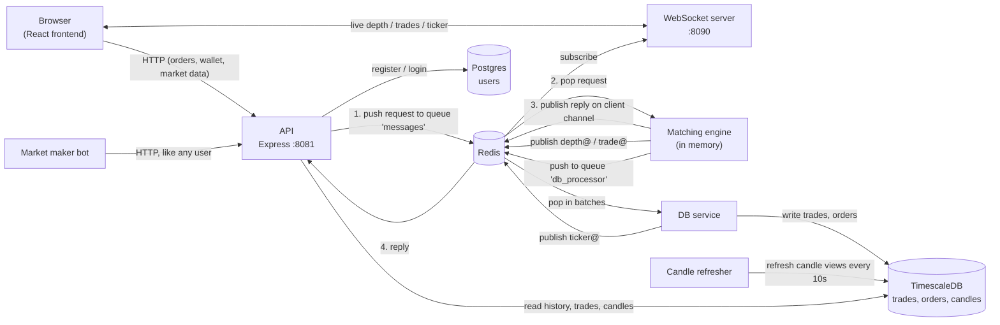

# CEX: a centralised exchange

A small, working centralised exchange. Users sign up, deposit (simulated) funds, place limit orders on a live order book, and watch trades, candles and prices update in real time.

The demo market is **TATA / INR**. Markets are defined in `backend/engine/src/trade/constants.ts`.

## Features

- Sign up / log in (JWT)
- Wallet with available and locked balances, simulated deposits
- Limit orders (buy / sell), cancel, open orders, order history
- Matching engine with price-time priority, partial fills and self-trade prevention
- Live order book, trades and 24h ticker over WebSocket
- Candlestick charts (1m, 1h, 1w) and trade history stored in TimescaleDB
- A market-maker bot that keeps the book liquid

## Quick start

Requirements: Node 20+, Docker Desktop.

```bash
npm run setup   # first time only: installs every package
npm run dev     # starts everything
```

Open http://localhost:5173. Press Ctrl+C to stop; `npm run infra:stop` also stops the Docker containers.

`npm run dev` does this, in order: starts Redis and TimescaleDB, builds the backend, creates the DB tables, then runs all services together.

| Service | Port | Folder |
|---|---|---|
| Frontend (React + Vite) | 5173 | `frontend` |
| API (Express) | 8081 | `backend/api` |
| WebSocket server | 8090 | `backend/ws` |
| Redis | 6380 | docker |
| TimescaleDB | 5432 | docker |

The API also needs `backend/api/.env` (see `.env.example`): `DATABASE_URL` for the user accounts (Postgres, via Prisma) and `JWT_SECRET`.

## Architecture



### What each part does

**Frontend** (`frontend`): React, Tailwind and shadcn/ui components. It calls the API over HTTP and keeps one WebSocket open for live updates. State lives in small Zustand stores.

**API** (`backend/api`): the only HTTP entry point. It handles accounts (register, login, JWT), validates every request, and then either:
- forwards trading requests (place order, cancel, balances, depth) to the engine through Redis, or
- reads history, trades, candles and tickers straight from TimescaleDB.

Users are stored in a separate Postgres database through Prisma. Trading routes require a valid token, and the user ID always comes from the token, never from the request body.

**Matching engine** (`backend/engine`): the core of the exchange. It runs as a single process and keeps all order books and balances in memory, so orders are handled one at a time and cannot race each other. For each order it:
1. locks the funds (a buy locks INR at its limit price, a sell locks the asset),
2. matches against the book (best price first, trades at the resting order's price),
3. settles balances for both sides and refunds any price improvement,
4. publishes the results.

It saves a snapshot to `backend/engine/data/snapshot.json` every 5 seconds and loads it on start, so state survives a restart.

**Redis**: the glue between services. The services never call each other directly. It plays three roles:
- a **request queue** (`messages`) from the API to the engine,
- **pub/sub** for replies (one channel per request) and for live streams (`depth@`, `trade@`, `ticker@`),
- a **write queue** (`db_processor`) from the engine to the DB service.

**WebSocket server** (`backend/ws`): browsers subscribe to streams such as `depth@TATA_INR`. It subscribes to the matching Redis channel once and fans each message out to every interested browser.

**DB service** (`backend/db`): reads the engine's events from the queue in batches and stores trades and orders in TimescaleDB. After a trade it publishes a fresh 24h ticker. A small cron script refreshes the 1m, 1h and 1w candle views every 10 seconds.

**Market maker** (`backend/mm`): a bot that logs in like a normal user and keeps about 15 bids and 15 asks around a moving price, so there is always liquidity to trade against.

### Data flow: placing an order

1. The browser sends `POST /api/v1/order` with its JWT.
2. The API validates it, subscribes to a one-off Redis channel, and pushes `{clientId, message}` onto the `messages` queue.
3. The engine pops the message, locks funds, matches the order and updates balances.
4. The engine publishes the result on the one-off channel, and the API returns it to the browser.
5. In parallel, the engine publishes `depth@` and `trade@` updates (the WebSocket server forwards these to browsers) and pushes order and trade events to `db_processor`.
6. The DB service stores them in TimescaleDB and publishes the new `ticker@` update. The candle views pick the trades up within 10 seconds.

### Redis channels and queues

| Name | Type | From → To | Content |
|---|---|---|---|
| `messages` | queue | API → engine | trading requests |
| `<random id>` | pub/sub | engine → API | reply to one request |
| `depth@MARKET` | pub/sub | engine → WS | changed order book levels |
| `trade@MARKET` | pub/sub | engine → WS | executed trades |
| `ticker@MARKET` | pub/sub | DB service → WS | 24h stats |
| `db_processor` | queue | engine → DB service | trades, order updates, cancels |

## API overview

| Method | Path | Auth | Purpose |
|---|---|---|---|
| POST | `/api/auth/register`, `/api/auth/login` | no | returns a JWT |
| GET | `/api/users/profile` | yes | current user |
| GET | `/api/v1/wallet` | yes | available and locked balances |
| POST | `/api/v1/wallet/deposit` | yes | simulated deposit `{asset, amount}` |
| POST | `/api/v1/order` | yes | place order `{market, side, price, quantity}` |
| DELETE | `/api/v1/order` | yes | cancel `{market, orderId}` |
| GET | `/api/v1/order/open?market=` | yes | open orders |
| GET | `/api/v1/order/history?market=` | yes | all past orders |
| GET | `/api/v1/depth?symbol=` | no | order book |
| GET | `/api/v1/trades?symbol=` | no | recent trades |
| GET | `/api/v1/klines?symbol=&interval=1m\|1h\|1w` | no | candles |
| GET | `/api/v1/tickers?symbol=` | no | 24h stats |

WebSocket: send `{"method":"SUBSCRIBE","params":["depth@TATA_INR","trade@TATA_INR","ticker@TATA_INR"]}` (or `UNSUBSCRIBE`).

## Project layout

```
backend/
  api/       Express API, auth, Prisma (users)
  engine/    matching engine, balances, order books, tests
  ws/        WebSocket server
  db/        Redis → TimescaleDB writer, schema seed, candle refresher
  mm/        market-maker bot
  docker/    docker-compose: Redis + TimescaleDB
frontend/    React app
package.json root scripts (setup, dev, ...)
```

## Known limitations

- Amounts are JavaScript floats, so tiny rounding errors are possible. A real exchange should use integer amounts or a decimal library.
- Deposits are simulated: any logged-in user can credit themselves any amount. No real payments.
- Only limit orders, one market, one engine process (no horizontal scaling).
- Ports 6380 / 8090 are used instead of the Redis / WebSocket defaults to avoid clashing with other local projects. If you run a service on its own, set `REDIS_URL`, `WS_PORT` and `VITE_WS_URL` to match.

## Tests

```bash
npm --prefix backend/engine test
```
